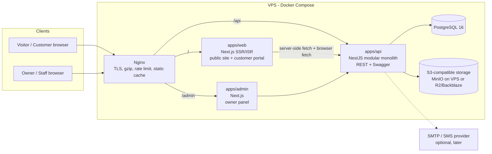
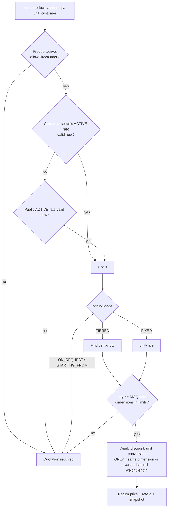

# Sanjana Plastic & Business Link — System Architecture (Phase 0)

Status: **PROPOSAL for approval. No code written.**
Companion: [02-database-erd.md](02-database-erd.md)

## 1. Principles

- One real client, one VPS, small team → **modular monolith**, not microservices.
- Server is the single source of truth for prices, eligibility and money. The browser is never trusted for any amount.
- Build only what the owner needs: catalog, rates, customization, quotes, orders, receivables, CMS. No ERP/GL/BOM/payroll/multi-tenant.
- Nothing invented: PAN, VAT, email, domain, prices, stock, capacity, QR, gateway are blank until supplied via admin.

## 2. Logical architecture



Decisions
| # | Decision | Reason |
|---|---|---|
| A1 | Two Next.js apps (`web`, `admin`) as in the brief; shared `packages/ui`, `types`, `config` | Admin bundle never ships to the public; separate auth audience; independent deploys |
| A2 | `/admin` is served by `apps/admin` behind Nginx path routing (same domain, avoids CORS and cookie-domain issues) | Simpler cookies/CSRF |
| A3 | NestJS REST + OpenAPI; types generated from the OpenAPI spec into `packages/types` | One contract, no drift |
| A4 | Public pages use SSR/ISR (revalidate on admin publish) | SEO + speed on low-end mobile networks |
| A5 | No Redis/BullMQ in v1. Background work = `Notification` outbox table drained by `@nestjs/schedule` in the API process; PDF generation done inline/async per request | No real queue requirement; fewer moving parts on one VPS. Revisit if email/SMS volume or PDF load grows |
| A6 | Object storage is S3-compatible behind a `StorageService` interface | Start with MinIO on the VPS, switch to a managed bucket with zero code change |
| A7 | Quotation/invoice PDFs: `pdfmake` or `@react-pdf/renderer` (no headless Chromium) | Small VPS memory footprint; Nepali (Devanagari) font embedded |

## 3. API modular monolith

```
apps/api/src/modules/
  auth/            login, register, refresh, logout, forgot/reset, guards
  customers/       profile, business profile, addresses, approval status
  categories/      CRUD, reorder, enable/disable
  products/        products, variants, images, specs, visibility
  rates/           units, rates, tiers, history, price-resolution service (PricingService)
  customizations/  config limits, saved designs, validation, design assets, approvals
  inquiries/       inbound requests, marketing leads
  quotations/      quotation + revisions, PDF, accept/reject, convert-to-order
  orders/          create (transactional), status machine, history, cancel rules
  invoices/        issue, void, numbering
  payments/        record, allocate, reverse, customer statement, dues/overdue
  cms/             site content, homepage sections, banners, gallery, static pages, SEO
  files/           upload, validate, scan, signed URLs
  reports/         KPIs, most-requested products, dues
  settings/        business profile, tax, feature flags
  common/          audit, notifications outbox, document sequences, pagination, errors
```

Module rules
- Modules talk through exported **services**, never by importing another module's Prisma queries.
- `PricingService` (in `rates`) is the only code that computes a price; `orders`, `quotations` and the public price display all call it.
- `OrderService.create()` and `PaymentService.allocate()` are the two money-critical transactions (see ERD §5, §6).
- Every write by staff emits an `AuditLog` row via an interceptor.

### Pricing resolution (server-side)



## 4. Security architecture

| Area | Design |
|---|---|
| Passwords | argon2id; min length + breached-pattern check; generic login errors |
| Sessions | Short-lived access JWT (≈15 min) + rotating refresh token, both in **httpOnly, Secure, SameSite=Lax cookies**; refresh token hash stored in `Session`; reuse detection revokes the family |
| Audiences | Customer tokens and staff tokens have different `aud`; admin API routes reject customer tokens and vice versa |
| CSRF | SameSite cookies + double-submit CSRF token on state-changing requests |
| Authorization | Role→Permission guard (`@RequirePermission('rates.write')`); customer routes derive `customerId` from the token, **never from request params**; Prisma queries always include `customerId` filter; automated tests assert cross-customer access returns 404 |
| Rate limiting | Nginx + Nest throttler: strict on login, register, forgot-password, quote/inquiry forms; CAPTCHA (e.g. Cloudflare Turnstile) on public forms if abuse appears |
| Input | Zod schemas on the web, `class-validator`/Zod pipes on the API; Prisma parameterized queries; output encoding by React |
| Uploads | Allowlist PNG/JPG/SVG/PDF; size caps; **magic-byte sniffing** (ignore client MIME); re-encode raster images (strips EXIF/polyglots); **SVG sanitized** (DOMPurify/SVGO strip scripts, external refs) and served from a separate cookieless asset origin with `Content-Disposition`/CSP; PDF checked for active content; antivirus (ClamAV) optional; random object keys; private bucket + signed URLs for customer files |
| Data protection | TLS only (Let's Encrypt), HSTS, security headers/CSP, secrets via env/Docker secrets, DB not exposed publicly, nightly encrypted `pg_dump` + restore test, uploads backed up |
| Money integrity | `Decimal` end to end, row-level locks on allocation, constraint triggers, append-only AuditLog |
| Privacy | PAN/VAT visible only to owner and the customer themselves; marketing leads store consent; Privacy Policy page |
| Payments | No gateway, no stored card data. Manual payment recording only until a verified workflow is approved. The card's QR is **not** reproduced until the original QR and account details are confirmed. |

## 5. Frontend architecture

- Next.js App Router, TypeScript, Tailwind, shadcn/ui, React Hook Form + Zod, TanStack Query for client interactivity (customizer, account, admin tables).
- Server Components for catalog/SEO pages; client components only where interactive.
- i18n: English default, Nepali (`ne`) via route segment or locale cookie; every user-facing catalog/CMS field has `En`/`Ne` columns. Noto Sans Devanagari self-hosted.
- Design tokens (from the card): Navy `#12336B`, Brand Red `#D83B55`, Green `#21876D`, Background `#F8FAFC`, Text `#172033`. Mobile-first. Logo used only from a client-approved source asset.
- Bag preview: SVG-based 2D template (tote / handle / D-cut / fabric) recolored via CSS variables; logo placed from `DesignAsset.placement`; labelled "Approximate preview".
- Admin: dense but simple tables (TanStack Table), 14 sidebar items max (matches brief), role-aware menu.

## 6. Page map

**Public / customer (`apps/web`)**
`/` · `/products` · `/products/[slug]` · `/categories/[slug]` · `/customize/[productId]` · `/request-quotation` · `/about` · `/contact` · `/login` · `/register` · `/forgot-password` · `/reset-password` · static policies (`/privacy`, `/terms`, `/returns`, `/delivery`) · `/account` · `/account/orders` (+`/[id]`) · `/account/quotations` (+`/[id]`) · `/account/payments` (statement, invoices) · `/account/designs` · `/account/profile` (+addresses) · `sitemap.xml` · `robots.txt`

**Admin (`apps/admin`)**
`/admin/login` · `/admin/dashboard` · `/admin/products` · `/admin/categories` · `/admin/product-rates` · `/admin/customers` · `/admin/inquiries` · `/admin/quotations` · `/admin/orders` · `/admin/payments` · `/admin/customer-dues` · `/admin/content` · `/admin/gallery` · `/admin/banners` · `/admin/reports` · `/admin/settings` (+ Marketing Leads under Inquiries tab)

## 7. Key workflows

**Customer order**
```mermaid
sequenceDiagram
  participant C as Customer
  participant W as Web
  participant A as API
  participant D as PostgreSQL
  C->>W: Configure product + qty
  W->>A: POST /pricing/quote-check (config)
  A-->>W: price or QUOTATION_REQUIRED
  alt eligible and priced
    C->>W: Place order
    W->>A: POST /orders (items, addressId)
    A->>D: BEGIN; re-price; validate; lock sequence
    A->>D: insert Order, OrderItems(snapshots), History, Audit
    A->>D: COMMIT
    A-->>W: order confirmation
  else needs quote
    C->>W: Request quotation
    W->>A: POST /inquiries (+ design)
  end
```

**Quotation lifecycle**: `Inquiry NEW` → admin creates `Quotation` + `Revision 1` → `SENT` (PDF) → customer/ admin `ACCEPTED` or admin `REVISED` (Revision n+1, old kept) → `CONVERTED` to `Order`.

**Receivables**: Order delivered/confirmed → admin issues `Invoice` → payments recorded → allocated → balance/dues/statement derived by query.

## 8. Reports & dashboard KPIs (all query-derived)

Total orders; today's orders; monthly order value (Order.total by `placedAt`); invoiced sales (issued non-void invoices); payments received (non-reversed); outstanding balance (Σ invoices − Σ allocations); pending inquiries / quotations / orders (status counts); total customers; most-requested products (OrderItem + QuotationItem + inquiry counts). Reads hit indexed tables; no materialized views needed at this size.

## 9. Infrastructure & delivery

- Docker Compose on a VPS: `nginx`, `web`, `admin`, `api`, `postgres`, `minio` (optional), `certbot`.
- GitHub Actions: lint + typecheck + unit/integration tests (Postgres service) → build images → deploy over SSH → `prisma migrate deploy` → health check; manual approval for production.
- Environments: local (docker-compose), staging (optional small VPS), production.
- Observability: structured logs (pino), `/health` and `/ready` endpoints, uptime check, error tracking (e.g. Sentry free tier) — optional.
- Backups: nightly `pg_dump` + object-storage sync to a second location; quarterly restore drill.

## 10. Testing strategy

- Unit: PricingService, unit conversion, status machine, dimension validation.
- Integration (real Postgres): order creation transaction, payment allocation limits, rate overlap constraint, quotation revisions immutability.
- Security: cross-customer access (IDOR) tests on every `/me` route, upload abuse samples, auth rate limits.
- E2E (Playwright): browse → customize → register → quote → order → track.

## 11. Phase plan (mapped to the brief)

| Phase | Deliverable | Gate |
|---|---|---|
| 0 | This document + ERD + open questions (**current**) | Client/owner approves |
| 1 | Branded frontend mockups (homepage, catalog, product, customizer, account, admin dashboard) with clearly-marked demo data | UI direction approved |
| 2 | Monorepo, auth, customers, catalog, admin products | |
| 3 | Specs, units, rates, customizer, quotation requests | |
| 4 | Ordering + tracking | |
| 5 | Admin orders, invoices, payments, dues, reports | |
| 6 | CMS, SEO, security tests, deployment | |

## 12. Information still required from the client (do not guess)

1. **The visiting-card photograph** was not attached to this session; business details above come from the brief only. Please supply the image (logo source asset and QR are needed; the QR stays inactive until verified).
2. Confirm spelling/phones/address, email, WhatsApp number, business hours, domain.
3. PAN / VAT numbers and whether VAT is charged.
4. Which categories/products actually exist now; first product photos.
5. Approved rate list and rate-validity practice.
6. Customer approval policy, credit terms, delivery policy/areas.
7. Manufacturing limits (min/max bag sizes, min order quantity, printing options, artwork turnaround).
8. Preferred notification channel (email, SMS, call).
9. Hosting/domain/bucket accounts and who owns them.
10. Nepali translations source.
