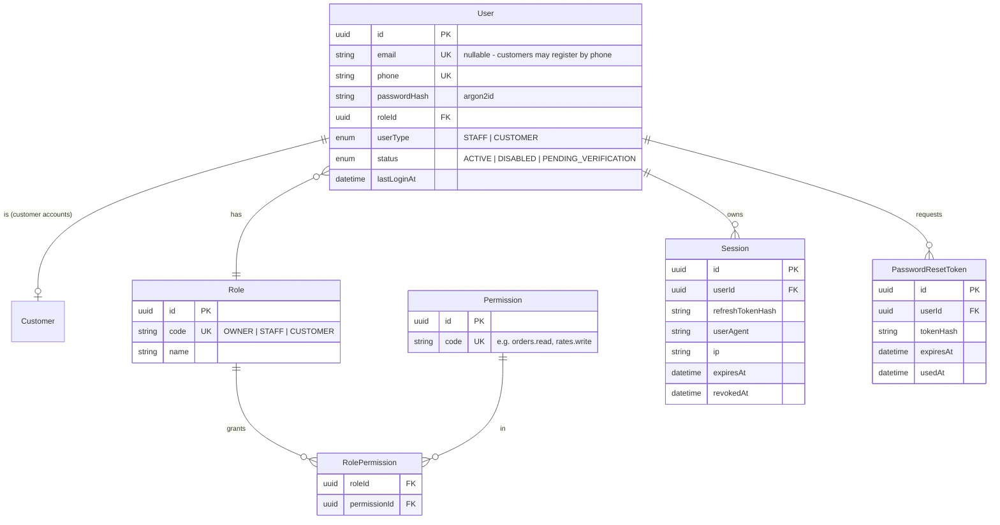
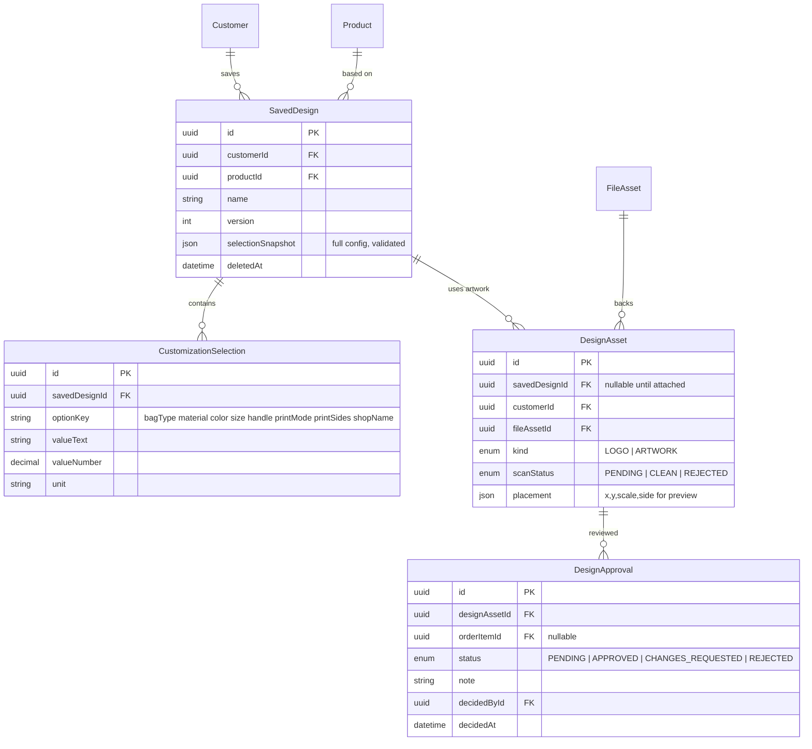
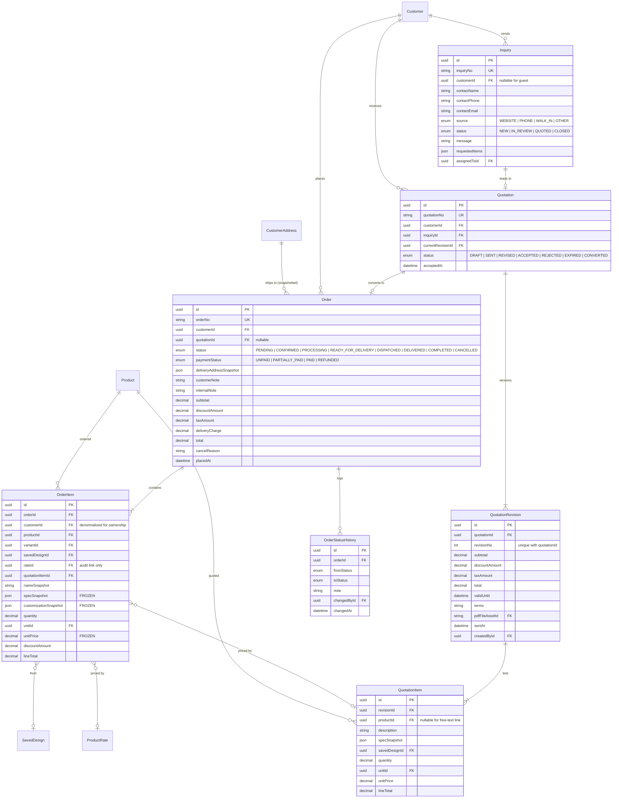
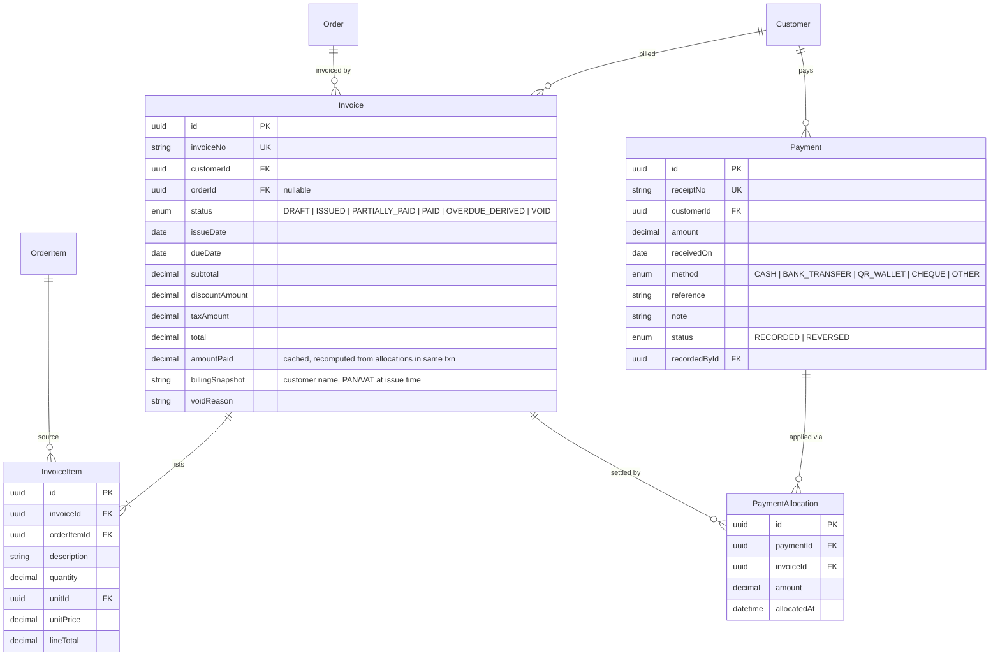

# Sanjana Plastic & Business Link — Database ERD (Phase 0)

Status: **PROPOSAL for approval — no Prisma migration has been generated.**
Database: PostgreSQL 16 · ORM: Prisma · Currency: NPR (configurable)

The ERD is split into 7 domain diagrams so each stays readable. Cross-domain references are shown as plain FK fields.

## 0. Global conventions

| Topic | Rule |
|---|---|
| Primary keys | `uuid` (v7 if available, for index locality). Human-facing numbers (ORD-2026-0001, INV-…, QTN-…) are separate unique columns generated from `DocumentSequence` inside the same transaction. |
| Money | `Decimal(14,2)` for totals/payments. `Decimal(14,4)` for unit rates (a per-gram or per-piece rate can need 4 places). Never `Float`. |
| Quantities | `Decimal(14,3)` (kg, metres, pieces all fit). |
| Dimensions | Stored in a canonical unit (mm for width/height/gusset/thickness in micron) plus the user-entered unit is kept in the snapshot. |
| Timestamps | `createdAt`, `updatedAt` on every mutable table; `deletedAt` (soft delete) only on Product, Category, Customer. Financial/historical rows are never deleted. |
| Statuses | Postgres enums, explicit. Order status and payment status are separate columns. |
| Ownership | Every customer-owned row carries `customerId` (directly, not only via a parent) so API guards and queries can always filter `WHERE customerId = :me`. |
| Immutability | Once created, these are never UPDATEd (new row instead): `ProductRate` (price terms), `QuotationRevision` + items, `OrderItem` snapshot columns, `OrderStatusHistory`, `PaymentAllocation`, `AuditLog`. Enforced in service layer + DB trigger on the snapshot columns. |
| Nothing invented | PAN, VAT, email, domain, prices, stock, capacity, delivery promises, certifications, gateway keys live only in `SiteSetting` / admin-entered data and are `NULL` until supplied. |

---

## 1. Identity & access



Notes
- One `User` table for staff and customers, separated by `userType` and `Role`. Admin app only accepts `STAFF`; web app only accepts `CUSTOMER` (enforced by separate auth audiences, see architecture doc).
- Customer needs at least one of email/phone (CHECK constraint). Phone is the primary identifier for Nepal SMEs.
- Seed roles: `OWNER` (all), `STAFF` (no settings/audit), `CUSTOMER`. Permission rows exist so a future "Accounts clerk" role needs no schema change.

---

## 2. Customers

```mermaid
erDiagram
  Customer ||--o| CustomerBusinessProfile : has
  Customer ||--o{ CustomerAddress : has
  Customer ||--o{ SavedDesign : saves

  Customer {
    uuid id PK
    uuid userId FK UK
    string customerNo UK "CUST-0001"
    string fullName
    enum orderingStatus "BROWSE_ONLY | APPROVED | SUSPENDED"
    decimal creditLimit "nullable, owner-set"
    int creditDays "nullable, default invoice terms"
    string internalNotes
    datetime deletedAt
  }
  CustomerBusinessProfile {
    uuid id PK
    uuid customerId FK UK
    string shopName
    string panNumber "nullable"
    string vatNumber "nullable"
    string businessType "retailer, restaurant, ..."
  }
  CustomerAddress {
    uuid id PK
    uuid customerId FK
    enum kind "BUSINESS | DELIVERY | BILLING"
    string line1
    string wardTole
    string municipality
    string district
    string landmark
    string contactPhone
    boolean isDefault
  }
```

Notes
- `orderingStatus` implements "eligible customer": registration creates `BROWSE_ONLY`; owner flips to `APPROVED` (or auto-approve via a setting). Quote requests are always allowed for logged-in customers.
- PAN/VAT optional (not required for browsing, per brief).
- `SavedDesign` is defined in §4.

---

## 3. Catalog, units & rates

```mermaid
erDiagram
  Category ||--o{ Category : "parent (optional)"
  Category ||--o{ Product : contains
  Product ||--o{ ProductVariant : has
  Product ||--o{ ProductImage : shows
  FileAsset ||--o{ ProductImage : backs
  Product ||--o{ ProductSpecValue : describes
  SpecDefinition ||--o{ ProductSpecValue : defines
  Material ||--o{ Product : "default material"
  Material ||--o{ ProductVariant : uses
  Color ||--o{ ProductVariant : uses
  MeasurementUnit ||--o{ ProductRate : "priced in"
  MeasurementUnit ||--o{ Product : "base unit"
  ProductVariant ||--o{ ProductRate : priced
  Product ||--o{ ProductRate : priced
  Customer ||--o{ ProductRate : "customer-specific (optional)"
  ProductRate ||--o{ QuantityPriceTier : tiers
  Product ||--o| CustomizationConfig : "customizable via"
  Product ||--o{ SizeOption : "standard sizes"

  Category {
    uuid id PK
    string slug UK
    string nameEn
    string nameNe
    uuid parentId FK
    int sortOrder
    boolean isActive
    datetime deletedAt
  }
  Product {
    uuid id PK
    uuid categoryId FK
    string slug UK
    string nameEn
    string nameNe
    enum productType "ROLL_MATERIAL | FINISHED_BAG | CUSTOM_MADE"
    string descriptionEn
    string descriptionNe
    uuid baseUnitId FK
    enum visibility "PUBLISHED | HIDDEN | DRAFT"
    enum availability "AVAILABLE | OUT_OF_STOCK | ON_REQUEST"
    enum priceDisplay "SHOW_PRICE | STARTING_FROM | PRICE_ON_REQUEST"
    boolean allowDirectOrder
    boolean isFeatured
    decimal minOrderQty
    decimal advisoryStockQty "nullable, NOT an inventory ledger"
    int sortOrder
    datetime deletedAt
  }
  ProductVariant {
    uuid id PK
    uuid productId FK
    string sku UK "nullable"
    uuid materialId FK
    uuid colorId FK
    decimal widthMm
    decimal lengthM "rolls"
    decimal heightMm "bags"
    decimal gussetMm "bags"
    decimal thicknessMicron
    decimal gsm
    decimal rollWeightKg "THIS roll's weight, not assumed"
    string handleType "enum-like, admin list"
    boolean isActive
  }
  ProductImage {
    uuid id PK
    uuid productId FK
    uuid fileAssetId FK
    string altText
    int sortOrder
    boolean isPrimary
  }
  SpecDefinition {
    uuid id PK
    enum appliesTo "ROLL_MATERIAL | FINISHED_BAG | CUSTOM_MADE"
    string key UK
    string labelEn
    string labelNe
    enum dataType "TEXT | NUMBER | ENUM | BOOLEAN"
    string unitLabel
    json enumOptions
    boolean isFilterable
    int sortOrder
  }
  ProductSpecValue {
    uuid id PK
    uuid productId FK
    uuid specDefinitionId FK
    string value
  }
  Material {
    uuid id PK
    string code UK
    string nameEn
    string nameNe
    enum family "PLASTIC | FABRIC | NON_WOVEN | OTHER"
    boolean isActive
  }
  Color {
    uuid id PK
    string nameEn
    string nameNe
    string hex
    boolean isActive
  }
  SizeOption {
    uuid id PK
    uuid productId FK
    string label "e.g. Small, 10x14"
    decimal widthMm
    decimal heightMm
    decimal gussetMm
    boolean isActive
  }
  MeasurementUnit {
    uuid id PK
    string code UK "pcs kg g m m2 roll bundle packet"
    string nameEn
    enum dimension "COUNT | MASS | LENGTH | AREA | CONTAINER"
    decimal toBaseFactor "nullable; only within same dimension (g->kg 0.001)"
    boolean isActive
  }
  ProductRate {
    uuid id PK
    uuid productId FK
    uuid variantId FK "nullable = all variants"
    uuid customerId FK "nullable = public rate"
    uuid unitId FK
    enum pricingMode "FIXED | STARTING_FROM | TIERED | ON_REQUEST"
    decimal unitPrice "nullable if ON_REQUEST"
    decimal minQty
    decimal discountPct "nullable"
    boolean taxInclusive
    datetime validFrom
    datetime validTo "nullable"
    enum status "DRAFT | ACTIVE | SUPERSEDED | EXPIRED"
    uuid supersedesRateId FK
    uuid createdById FK
  }
  QuantityPriceTier {
    uuid id PK
    uuid rateId FK
    decimal fromQty
    decimal toQty "nullable = open ended"
    decimal unitPrice
  }
  CustomizationConfig {
    uuid id PK
    uuid productId FK UK
    decimal minWidthMm
    decimal maxWidthMm
    decimal minHeightMm
    decimal maxHeightMm
    decimal minGussetMm
    decimal maxGussetMm
    decimal minOrderQty
    json allowedMaterialIds
    json allowedColorIds
    json allowedHandleTypes
    json allowedPrintModes
    boolean allowCustomSize
    boolean allowArtworkUpload
  }
```

Key design decisions

1. **Units are conversion-safe by construction.** `MeasurementUnit.dimension` groups units. Conversion is only allowed between two units of the same non-`CONTAINER` dimension (g↔kg, m↔m). `roll`, `bundle`, `packet` are `CONTAINER` and have **no** global factor — a roll's weight/length lives on the specific `ProductVariant` (`rollWeightKg`, `lengthM`). A kg-priced roll is billed as `variant.rollWeightKg × qty × rate/kg` only if `rollWeightKg` is set; otherwise the system forces a quotation. No assumed "standard roll".
2. **Price history = immutable rate rows.** Changing a price creates a new `ProductRate` (`supersedesRateId` → old row, old row → `SUPERSEDED`). Nothing is overwritten, so "price history" is a query, not a separate table. Overlap prevented by a Postgres exclusion constraint on `(productId, variantId, customerId, unitId)` + `tstzrange(validFrom, validTo)` for `ACTIVE` rows.
3. **Rate resolution order (server-side only):** customer-specific active rate → public active rate; within it, matching `QuantityPriceTier` by quantity; then discount. No match, `ON_REQUEST`, or quantity < MOQ → **quotation required**.
4. **Product types** drive which `SpecDefinition` rows apply (GSM/width/length/roll weight for rolls; thickness/width/height/gusset/handle for bags). Typed numeric columns on `ProductVariant` serve filtering and pricing; `ProductSpecValue` carries descriptive extras so admin can add attributes without migrations.
5. **Stock is advisory.** `availability` + optional `advisoryStockQty`. No stock ledger (explicitly out of scope). Hidden/out-of-stock handled by `visibility`/`availability`.
6. **Categories** are admin-configurable (rename, enable/disable, reorder via `sortOrder`); the 11 initial categories are seed data, `nameNe` filled by the client.

---

## 4. Customization & design assets



Notes
- Brief lists `ProductCustomization`; here it is named **`SavedDesign`** (it is the customer's saved customization, powering "Saved Custom Designs" + "Repeat order"). `CustomizationSelection` rows are queryable options; `selectionSnapshot` JSON is the exact validated payload.
- Preview is approximate; `DesignApproval` is the human sign-off that print artwork is acceptable before production. Order cannot move to `PROCESSING` if an item with custom artwork has no `APPROVED` approval (service rule).

---

## 5. Sales: inquiries, quotations, orders



Rules enforced in a single DB transaction at order creation
1. Re-resolve every price from `ProductRate`/`QuantityPriceTier`/`QuotationItem` server-side; reject if client-sent price differs.
2. Check `customer.orderingStatus = APPROVED`, `product.allowDirectOrder`, rate valid at `now()`, qty ≥ MOQ, dimensions within `CustomizationConfig`.
3. Allocate `orderNo` from `DocumentSequence` (`SELECT … FOR UPDATE`).
4. Write `Order`, `OrderItem` (with frozen snapshots), first `OrderStatusHistory`, `AuditLog`, `Notification`.
5. Order from quotation: only from `ACCEPTED` quotation's **current** revision; items copied from `QuotationItem`; quotation → `CONVERTED`; unique on `Order.quotationId`.

Status transitions are a whitelist in code (e.g. `PENDING→CONFIRMED→PROCESSING→READY_FOR_DELIVERY→DISPATCHED→DELIVERED→COMPLETED`; `CANCELLED` allowed only before `DISPATCHED`, with reason). `paymentStatus` is **derived** from invoice allocations, never set by hand.

---

## 6. Finance (receivables only — no general ledger)



Financial integrity rules
- `SUM(PaymentAllocation.amount WHERE paymentId) ≤ Payment.amount` (remainder = customer advance/unallocated credit).
- `SUM(PaymentAllocation.amount WHERE invoiceId) ≤ Invoice.total`.
- Both enforced by service logic under row locks (`SELECT … FOR UPDATE` on payment + invoice) **and** a constraint trigger as backstop.
- Invoice `OVERDUE` is **derived** (`dueDate < today AND outstanding > 0`), not stored, so it can never go stale.
- Outstanding balance per customer = Σ(issued invoice total) − Σ(allocations). Customer statement = invoices + payments ordered by date, with running balance computed in query. Overdue report = same query filtered by due date.
- Corrections: invoices are voided (not edited after issue); payments are `REVERSED` (allocations marked reversed through compensating rows). No deletes.
- Order value ≠ revenue: revenue ("Invoiced Sales") = issued, non-void invoices; "Payments Received" = non-reversed payments; neither is read from `Order.total`.
- Tax: `taxAmount` and rate come from `SiteSetting` (VAT rate/registration to be confirmed with client — not assumed).
- No QR/online gateway tables yet. `Payment.method = QR_WALLET` is just a manual record until the verified payment workflow is approved.

---

## 7. Content, marketing & platform

```mermaid
erDiagram
  SiteSetting {
    string key PK "business.name, contact.phones, tax.pan, ..."
    json value
    boolean isPublic
    uuid updatedById FK
  }
  BusinessProfile {
    uuid id PK
    string nameEn
    string nameNe
    uuid logoFileAssetId FK
    string address
    json phones
    string email "nullable"
    string whatsapp "nullable, verified only"
    string panNumber "nullable"
    string vatNumber "nullable"
    json businessHours
    json socialLinks
  }
  HomepageSection {
    uuid id PK
    string key UK "hero, categories, featured, ..."
    json contentEn
    json contentNe
    int sortOrder
    boolean isActive
  }
  Banner {
    uuid id PK
    uuid imageFileAssetId FK
    string title
    string linkUrl
    datetime startsAt
    datetime endsAt
    int sortOrder
    boolean isActive
  }
  GalleryImage {
    uuid id PK
    uuid fileAssetId FK
    string caption
    int sortOrder
    boolean isActive
  }
  StaticPage {
    uuid id PK
    string slug UK "about, privacy, terms, returns, delivery"
    string titleEn
    string bodyEn
    string titleNe
    string bodyNe
    boolean isPublished
  }
  SeoSetting {
    uuid id PK
    string targetType "PAGE | PRODUCT | CATEGORY | GLOBAL"
    string targetId
    string title
    string description
    uuid ogImageFileAssetId FK
    string canonicalUrl
  }
  MarketingLead {
    uuid id PK
    string name
    string phone
    string email
    string shopName
    enum source "WEBSITE_FORM | INQUIRY | MANUAL | IMPORT"
    enum status "NEW | CONTACTED | INTERESTED | CONVERTED | LOST"
    uuid customerId FK "when converted"
    string note
    boolean consentToContact
  }
  FileAsset {
    uuid id PK
    string objectKey UK
    string originalName
    string mimeType "sniffed, not client-supplied"
    int sizeBytes
    string sha256
    enum purpose "PRODUCT_IMAGE | ARTWORK | LOGO | CMS | QUOTE_PDF | INVOICE_PDF"
    enum visibility "PUBLIC | PRIVATE"
    uuid ownerCustomerId FK "nullable"
    uuid uploadedById FK
  }
  Notification {
    uuid id PK
    uuid userId FK
    enum channel "IN_APP | EMAIL | SMS"
    string type "ORDER_STATUS, QUOTE_SENT, ..."
    json payload
    enum status "QUEUED | SENT | FAILED | READ"
    int attempts
    datetime sentAt
  }
  AuditLog {
    uuid id PK
    uuid actorUserId FK
    string action "rate.create, order.status, payment.reverse"
    string entityType
    string entityId
    json before
    json after
    string ip
    datetime createdAt
  }
  DocumentSequence {
    string key PK "ORD-2026, INV-2026, QTN-2026, RCPT-2026"
    int lastValue
  }
```



Notes
- `BusinessProfile` (single row) is the typed home for the identity fields; `SiteSetting` holds everything else (toggles, auto-approve customers, tax rate, bank/QR details once verified, policy flags). PAN/VAT print on the footer/invoices **only if non-null**.
- `FileAsset.visibility = PRIVATE` for customer artwork and PDFs → served only via short-lived signed URLs after an ownership check. `PUBLIC` for product/CMS images.
- `MarketingLead` stores `consentToContact`; no bulk SMS/email campaign engine is built (out of scope).
- `Notification` doubles as an outbox: a scheduled in-process worker drains `QUEUED` rows. Redis/BullMQ is not needed at this scale.

---

## 8. Index & constraint checklist

| Table | Index / constraint |
|---|---|
| User | unique(email), unique(phone), CHECK(email OR phone) |
| Customer | unique(userId), unique(customerNo), idx(orderingStatus) |
| Product | unique(slug), idx(categoryId, visibility, sortOrder), GIN trgm on names (search) |
| ProductRate | partial index `WHERE status='ACTIVE'` on (productId, variantId, customerId, unitId); exclusion constraint on validity range |
| QuantityPriceTier | unique(rateId, fromQty); CHECK(toQty IS NULL OR toQty > fromQty) |
| Quotation | unique(quotationNo), idx(customerId, status) |
| QuotationRevision | unique(quotationId, revisionNo) |
| Order | unique(orderNo), unique(quotationId), idx(customerId, status, placedAt DESC), idx(status, placedAt) |
| OrderItem | idx(orderId), idx(customerId), idx(productId) (most-requested-products KPI) |
| Invoice | unique(invoiceNo), idx(customerId, status), idx(dueDate) WHERE outstanding > 0 |
| PaymentAllocation | unique(paymentId, invoiceId), CHECK(amount > 0) |
| Payment | unique(receiptNo), idx(customerId, receivedOn) |
| FileAsset | unique(objectKey), idx(ownerCustomerId) |
| AuditLog | idx(entityType, entityId), idx(createdAt) — append-only (REVOKE UPDATE/DELETE) |
| Session | idx(userId), idx(expiresAt) |

## 9. Mapping to the model list in the brief

| Brief | This ERD |
|---|---|
| ProductSpecification | `SpecDefinition` + `ProductSpecValue` (+ typed columns on `ProductVariant`) |
| ProductCustomization | `SavedDesign` |
| SEOSettings | `SeoSetting` |
| SiteSettings / BusinessSettings | `SiteSetting` (key-value) + `BusinessProfile` |
| Session, Role, Permission | as specified (+ `RolePermission`, `PasswordResetToken`) |
| Added (needed) | `CustomizationConfig` (admin mfg limits), `MarketingLead`, `StaticPage`, `DocumentSequence`, `Notification` outbox |
| Not added on purpose | stock ledger, GL accounts, BOM, payroll, multi-tenant `tenantId` |

## 10. Items that need client confirmation before Prisma generation

1. Auto-approve new customers for direct ordering, or manual owner approval? (`orderingStatus`)
2. Is VAT charged on invoices? Rate and whether prices are tax-inclusive? (`taxInclusive`, `SiteSetting`)
3. Customer-specific rates: used at all in v1?
4. One invoice per order, or partial-delivery invoicing (multiple invoices per order)? Model supports both; UI will follow the answer.
5. Credit notes / returns: do they exist? (Not modelled; void + re-issue only.)
6. Nepali (`Ne`) content: client or HiTech supplies translations?
7. Delivery charge: free, flat, or quoted per order?
